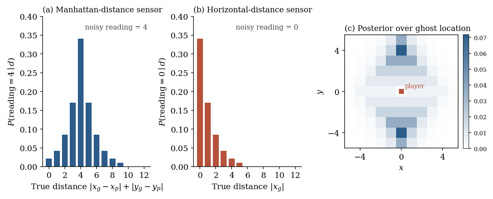

# Ghost Hunting with Bayesian Inference

An agent walks around a text adventure game, listening for a ghost it cannot see. Every sound it hears gives only a rough, noisy hint about where the ghost is. By combining many of these hints with probability, the agent works out the ghost's exact grid position and reports it once it is at least 95% sure.

## Purpose

The project shows how an agent can reach a confident, correct answer from information that is unreliable on its own. No single sensor reading is enough to find the ghost, but each one rules some places in or out a little. Adding up that evidence in a principled way, with Bayes' rule, lets the agent pin the ghost down.

## The game

The world comes from [TextWorld-Express](https://github.com/cognitiveailab/TextWorldExpress), a text adventure game: the player reads descriptions ("You are in the kitchen…") and types commands such as `move west` or `open door to south`.

- **Grid.** The rooms sit on a square grid. The player starts at `(0, 0)`. The ghost hides at a random cell inside a square from `(-d, -d)` to `(d, d)`, where `d` grows with the size of the map. That gives `(2d + 1)²` possible cells: 121 on the smallest maps and 1,849 on the largest.
- **Hidden ghost.** The ghost can be in a room or inside a wall, so the agent can never walk in and see it. The ghost does not move.
- **Goal.** Report the ghost's position, for example `report 3 -2`. A wrong guess ends the game.

## How the agent finds the ghost



### Step 1: Two noisy sensors

After every action the agent gets two readings:

1. **Ghost distance.** How far away the ghost sounds, as a **Manhattan distance**: the number of grid steps between the player and the ghost when you may only move up, down, left or right. From `(0, 0)` to `(3, -2)` that is 3 + 2 = **5**.
2. **Horizontal distance.** How far the ghost is from the grid's center, counting only left and right, `|x|`. A ghost at `(3, -2)` has horizontal distance **3**, wherever the player stands.

Both readings are **noisy**: the true value plus a random error. The error is usually zero and gets less likely the bigger it is; each extra step off is half as likely as the one before. With a true distance of 5, the sensor says 5 about 34% of the time, 4 or 6 about 17% each, 3 or 7 about 8.5% each, and so on.

Each reading comes as a list of probabilities, one per possible true distance. Panel (a) above shows a reading of 4. A true distance of 4 is the best explanation (34%), 3 or 5 are half as likely (17%), and so on. In probability terms, this list is the **likelihood**: for each possible true value, how likely it is to produce the reading we saw.

### Step 2: Start with a belief over every cell

The agent keeps a **probability distribution** over the grid: one number per cell saying how likely it is that the ghost is there, with all numbers adding up to 1. You can picture it as a heat map, like panel (c).

At the start the agent knows nothing, so every cell gets the same probability. This starting guess is called the **prior**. On a 121-cell grid, each cell starts at 1/121 ≈ 0.8%.

### Step 3: Update the belief with Bayes' rule

When a reading arrives, the agent updates every cell with **Bayes' rule**:

> new belief in a cell ∝ old belief in that cell × how well that cell explains the reading

Then it rescales all cells so they add up to 1 again. This rescaling is called **normalization**, and the updated belief is called the **posterior**.

*Example.* The player is at `(0, 0)` and hears the ghost at distance 4. Cell A, `(0, 4)`, is truly 4 steps away, so it explains the reading with likelihood 0.34. Cell B, `(0, 6)`, is 6 steps away, so its likelihood is only 0.085. If both started equally likely, A is now 4 times as likely as B.

The agent applies this update twice per move, once for each sensor. The horizontal sensor alone can only tell the ghost's column, and the distance sensor alone can only tell a diamond-shaped ring around the player. Together they narrow the possibilities to a few cells, as panel (c) shows.

### Step 4: Keep listening; the evidence adds up

The agent repeats the update after every move, multiplying in each new reading. This is the **forward algorithm** of a **hidden Markov model (HMM)**, a standard way to track something you cannot see directly:

- **Hidden state:** the thing you want to know but cannot observe, here the ghost's cell.
- **Observations:** the noisy clues you do see, here the two sensor readings.
- **Forward algorithm:** after each new clue, update the belief using everything seen so far, without recomputing from scratch. Normally an HMM also predicts how the hidden state moves between clues. The ghost stays put, so that step leaves the belief unchanged.

One noisy reading can be misleading, but random errors don't keep pointing the same wrong way. Over many readings the true cell keeps scoring well while wrong cells fall behind, much like averaging many rough measurements gives a precise answer.

### Step 5: Explore to break ties

Standing in one spot is not enough. From `(0, 0)`, the cells `(0, 4)` and `(0, -4)` are both 4 steps away and have the same horizontal distance, so no number of readings can tell them apart. Panel (c) shows exactly this pair as the two darkest cells.

So the agent keeps moving:

- It **opens every door** it sees, so more of the map is reachable.
- It takes a **random move** each turn. Every new position measures distance from a different spot, and that separates cells that looked identical from the old one. One step north, `(0, 4)` is 3 steps away but `(0, -4)` is 5.

### Step 6: Stop when confident

The agent reports a cell as soon as its probability goes above a confidence threshold **α (alpha)**. With α = 0.95, it waits until one cell holds more than 95% of the belief. A higher α means fewer wrong guesses, at the cost of listening for longer.

## Testing

`tests.py` runs the agent on **194 games**:

- **10 map layouts:** two map types (`coin` and `mapreader`), each in five sizes, from 5 to 20 rooms.
- **20 random seeds** per layout. A **random seed** fixes the random choices, such as where the ghost hides, so every run faces the same 194 setups.

That would be 200 games, but six fail to load in TextWorld and are skipped. Each game counts as passed only if the reported cell is exactly right, and the whole test passes if accuracy is at least α = 0.95.

## Result

- **Saved run (in the notebook):** found the ghost in **190 of 194 games, 97.9% accuracy**, above the 95% target.
- **Repeat runs:** because the agent moves at random, accuracy changes a little from run to run. Across 11 fresh runs, it ranged from 95.4% to 98.5% on the runs that passed (about 97% on average), and one run fell just below the 95% target.

## Files

| File | What it contains |
|---|---|
| `ghost_hunting.ipynb` | The agent (`run_agent`) and the test run with its output |
| `helpers.py` | The ghost game: hides the ghost and produces the two noisy sensor readings |
| `tests.py` | The 194-game test |
| `images/belief_update.png` | The figure above |

## Running it

Requires Python 3.10+ and Java 1.8 or newer (TextWorld-Express runs on Java).

```bash
pip install -r requirements.txt
jupyter notebook ghost_hunting.ipynb
```

The full test takes about 10 seconds.

## Credits

Built on an assignment from Georgia Tech's CS 3600 (Introduction to Artificial Intelligence), Spring 2025. The course provided the ghost game (`helpers.py`) and the test (`tests.py`); the agent in `run_agent` is my own work.
